# Mockup Studio

**Your own AI Play Store listing-graphics generator.** You drop your app's screenshots into a folder and describe each
screen. A planner agent (Claude Code, Codex or Muse) then designs an ASO-friendly deck, a template engine renders it as
HTML, and a builder agent reviews and refines it. The output is Play-ready PNGs at 1080×1920, plus a 1024×500 feature
graphic. Guardrails check every step, and a local dashboard lets you edit anything by hand.


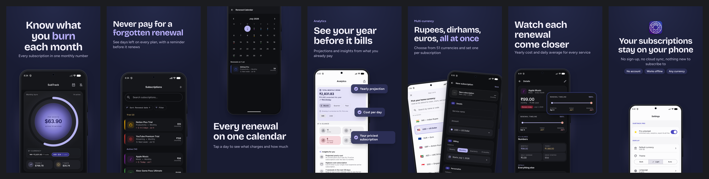
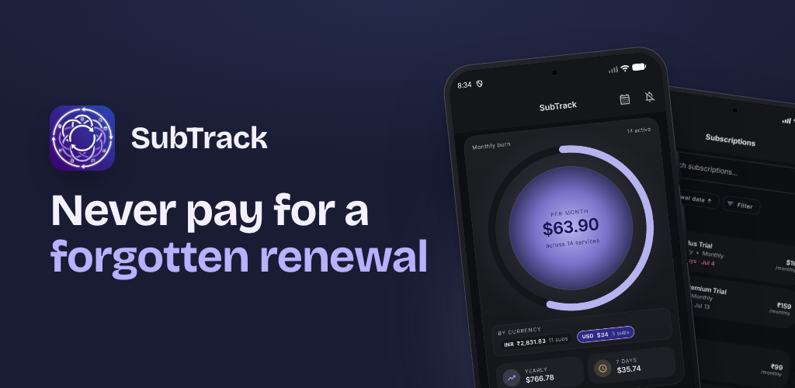

---

## Samples

Every SubTrack deck below started from the same 8 raw screenshots and [`app.json`](samples/subtrack-claude/app.json).
Each sample folder has `deck.png`, `feature-graphic.png`, half-size `slides/`, and the `plan.json` and `app.json`
that produced it.

### The same app, three agents

Each agent picked its own calm direction with the same skills, and all slides pass the guardrails.

| Agent | Result |
|---|---|
| **Claude Code** chose `harbor-night`, highlights on 4 of 7 slides |  |
| **Codex** chose a condensed grotesk, one highlight, and a custom stats zoom card | 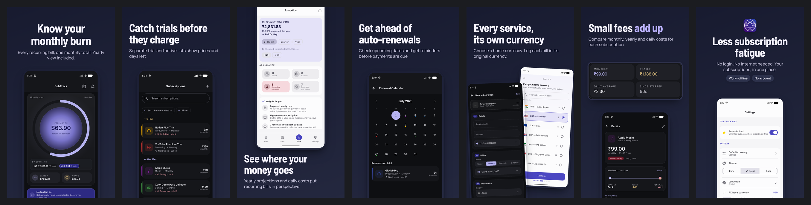 |
| **Muse** chose `fog-lilac`, a light take that inverts the dark UI | 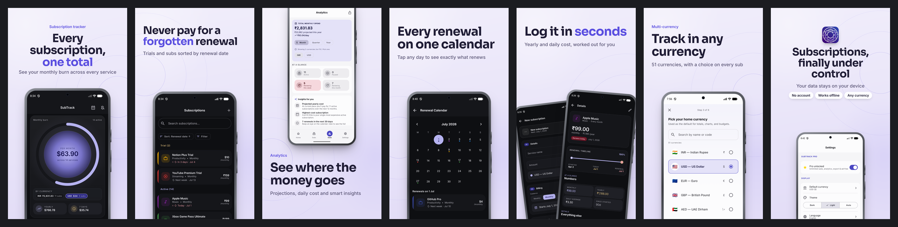 |

### Copy a look from a reference

Drop any sample listing into `input/reference/` and the agents reproduce its style on your screenshots. Left is the
reference, right is the result:

<p>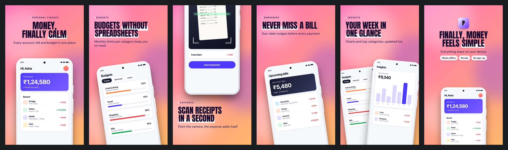 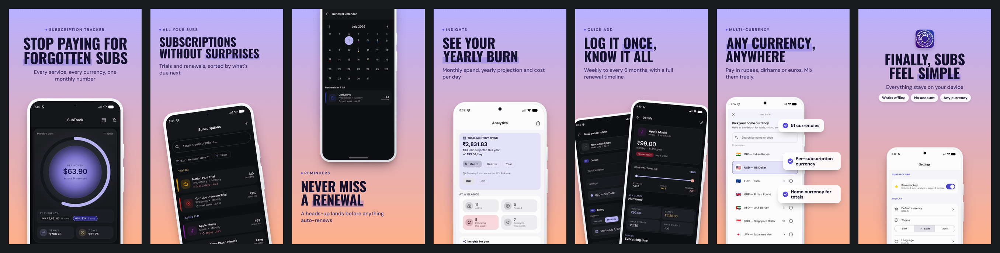</p>

### Calm presets

Five soothing presets join the expressive ones. Here is one plan rendered in each, with no AI and a few seconds per
deck: `sage-mist`, `sand-dune`, `harbor-night`, `dusk-rose`, `fog-lilac`.

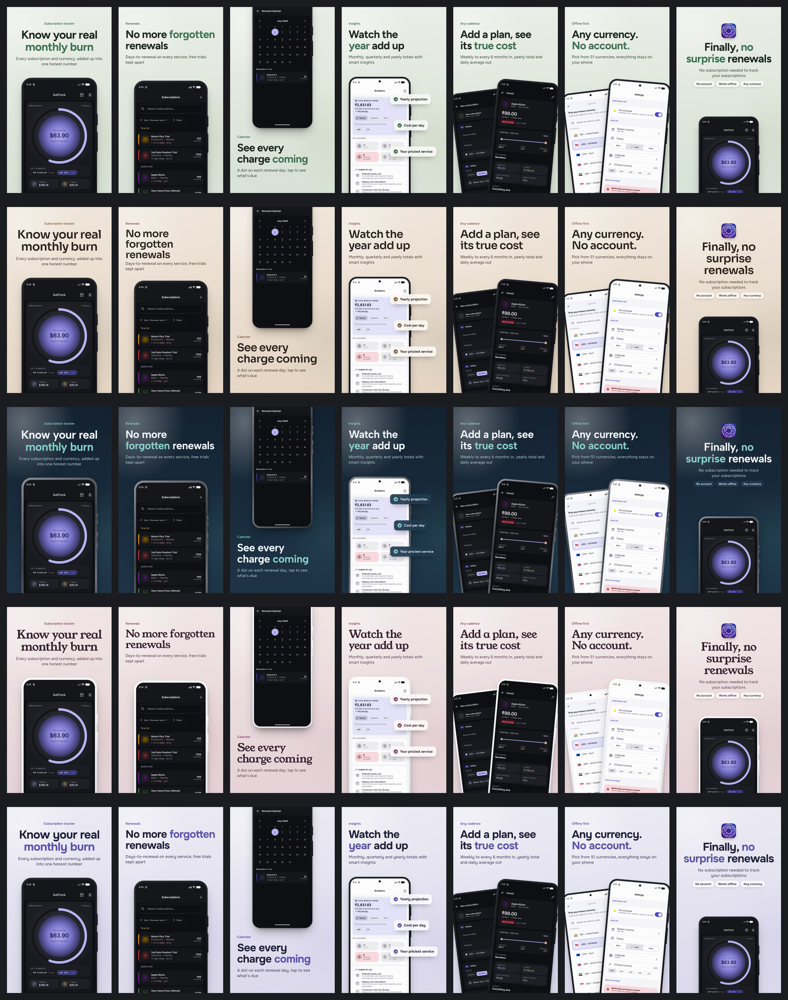

### Mockup Studio, listed by Mockup Studio

The dashboard was captured at phone size (`scripts/capture-dashboard.js`) and fed back in as an app. The Claude SubTrack
deck was given as the reference, so the tool designed its own listing in the same family:

<p> 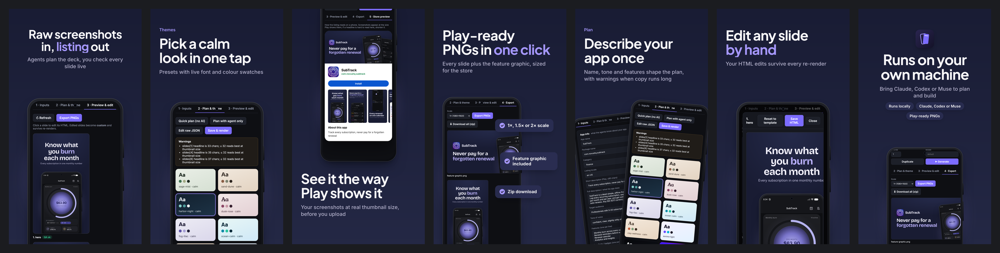</p>

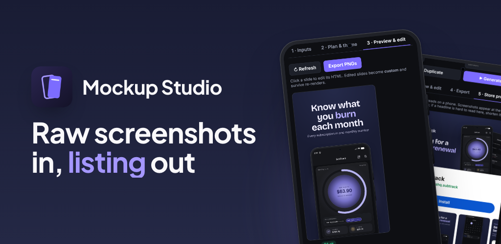

---

## Dashboard tour

The dashboard uses a forest-green sidebar, an ivory workspace, and a responsive five-step workflow.
Search projects by name, track screenshot-to-export progress, and expand generation settings when you need them.

| | |
|---|---|
| **Inputs**: app info, copy counters and per-screen descriptions<br>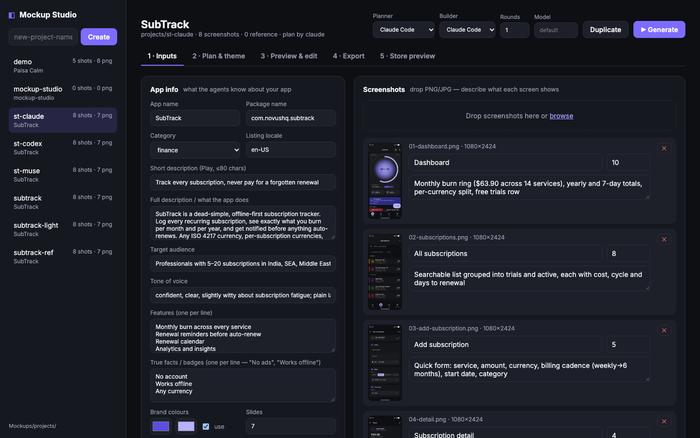 | **Theme gallery**: six curated themes, with all presets available to browse<br>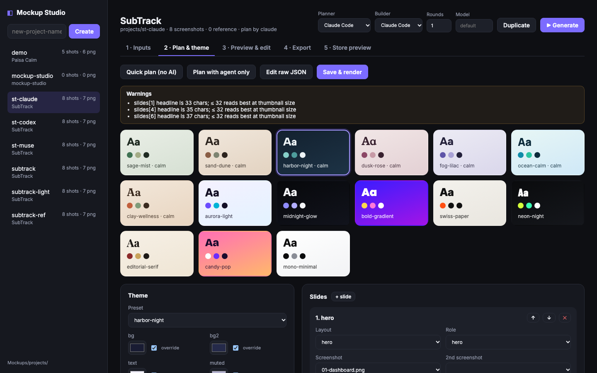 |
| **Slide editor**: layout, screenshots and copy per slide<br>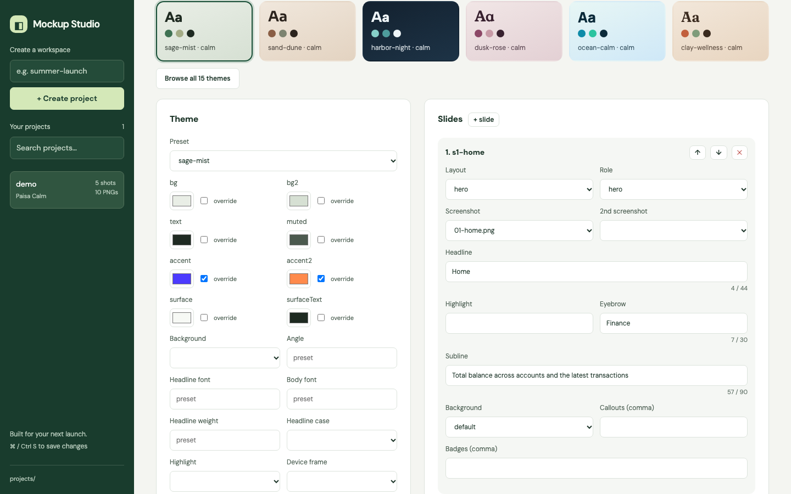 | **Previews** with a QA badge on every slide<br>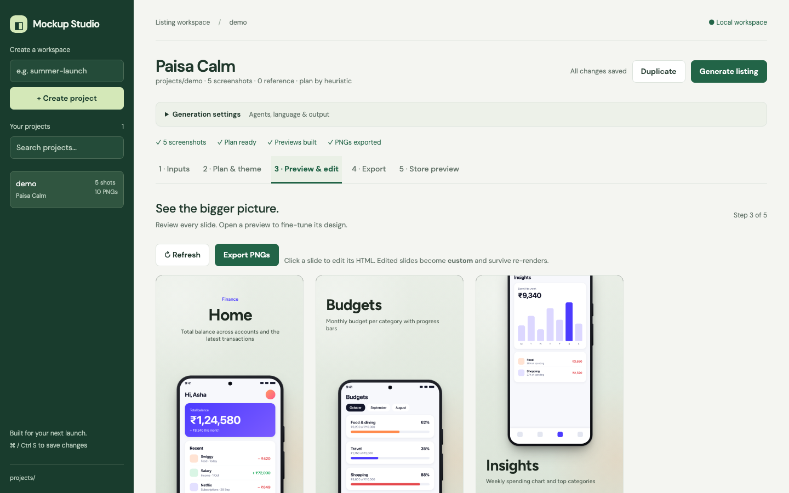 |
| **HTML editor**: hand edits survive re-renders<br>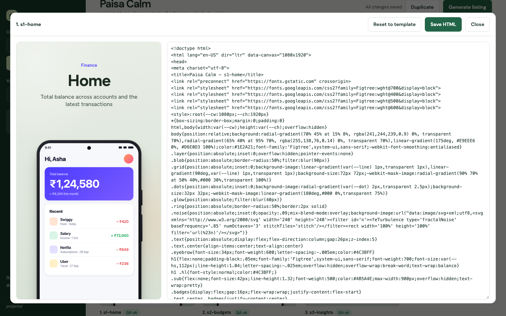 | **Export**: PNGs at 1×, 1.5× or 2×, plus a zip<br>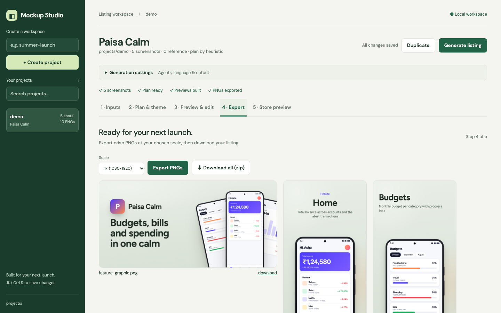 |
| **Store preview**: the deck at real Play thumbnail size<br>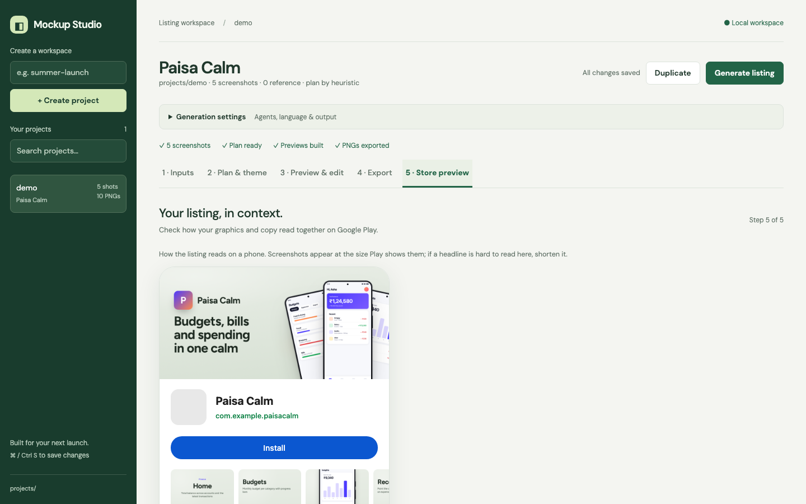 | **Activity**: live job output, available to reopen after closing<br>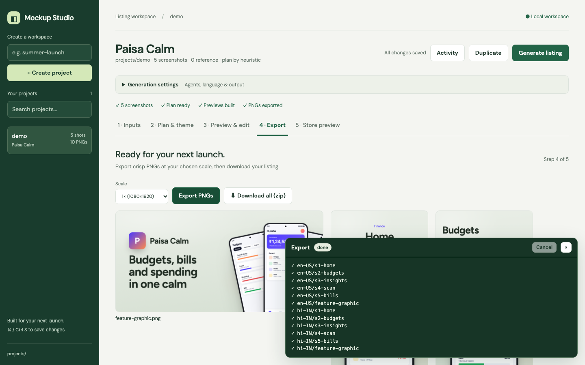 |
| **App view**: every listing of one app grouped, compared side by side<br>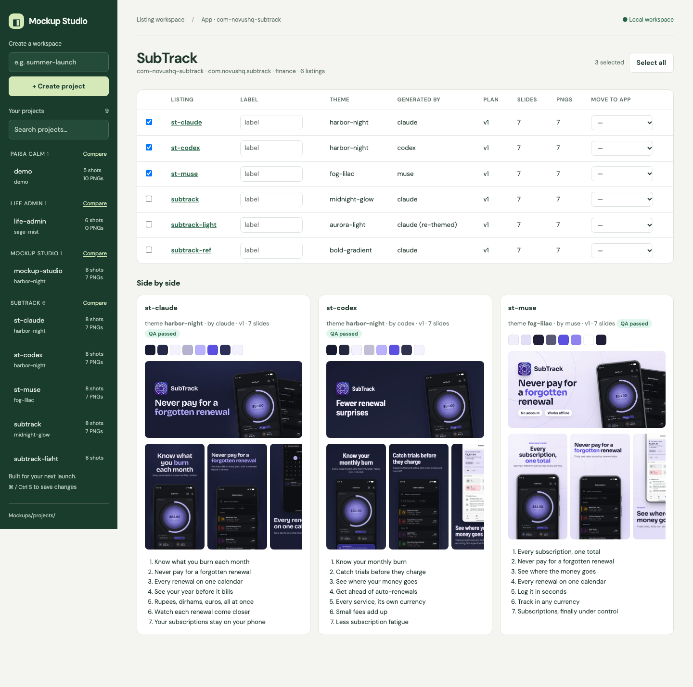 | |

The dashboard also has **Duplicate** to try a theme on a copy, keyboard-accessible uploads and previews,
**⌘/Ctrl + S** to save the current editor, and layouts that adapt from desktop to phone.

---

## Quick start

```bash
npm install
npx playwright install chromium
npm run demo                 # builds projects/demo and renders it (no AI)
npm start                    # dashboard → http://localhost:4280
```

You need Node 20+ and Playwright's Chromium browser. Agent CLIs are optional: expand **Generation settings** and
choose **Heuristic (no AI)** for Planner, **Template only** for Builder, and **Skip translation** for Translator
to generate locally without an AI agent. For AI planning or refinement, install and log in to `claude`, `codex`
or `muse` on your `PATH`. Check availability with `node src/cli.js agents`.

### Your own app in 4 steps

```bash
node src/cli.js new myapp
```

1. **Screenshots** → `projects/myapp/input/screenshots/`. Use raw captures (PNG/JPG). Name them in rough story order
   (`01-home.png`, …).
2. **App info** → the dashboard's Inputs tab, `PUT /api/projects/myapp/app`, or `mockup restore` of a dump. It is
   stored in SQLite; see [`samples/subtrack-claude/app.json`](samples/subtrack-claude/app.json) for its shape. The
   most important part is `screens`: for each file, say what it shows (`title`, `description`) and give it a
   `priority` (higher means earlier in the deck).
3. *Optional:* put a **sample listing whose look you want** in `input/reference/` (one or more images), and your
   **icon** at `input/icon.png`.
4. Generate:

```bash
node src/cli.js run myapp --planner claude --builder claude --rounds 1
```

PNGs land in `projects/myapp/export/phone/` and `export/feature/`. The dashboard does all of the above with drag-and-drop.

---

## How it works

```
input/screenshots + app.json (+ reference images)
        │
        ▼
 ┌──────────────┐  skills/planner.md + specs + ASO + design system (+ theme replication)
 │ PLANNER agent│  looks at every image → writes plan.json
 └──────┬───────┘
        ▼  guardrail: JSON schema, files exist, highlight ⊂ headline, policy copy, WCAG contrast
        │  (rejected → errors fed back, up to 3 tries → heuristic fallback)
 ┌──────────────┐
 │ RENDERER     │  src/templates: 39 theme presets, 8 phone layouts, 3 feature-graphic layouts,
 │ (deterministic)│ CSS Android frame, auto-fit headlines → build/<slide>.html
 └──────┬───────┘
        ▼
 ┌──────────────┐  Playwright/Chromium → 24-bit PNG, no alpha (Play rule)
 │ EXPORT + QA  │  checks: canvas size, safe area, min font, clipping, headline over screen,
 └──────┬───────┘  only Google Fonts allowed as network → .runs/qa.json + contact sheet
        ▼
 ┌──────────────┐  skills/builder.md — reviews contact sheet vs reference, edits plan.json
 │ BUILDER agent│  or hand-edits build/<slide>.html ("mode": "custom")
 └──────┬───────┘
        ▼  guardrail: invalid plan → rollback; custom slide failing QA → reverted to template
     export/phone/*.png  export/feature/feature-graphic.png
```

Everything an agent produces is checked by code, never trusted. The worst case is a clean template deck.

---

## The agent skills (`skills/`)

The pipeline inlines these into each agent's prompt. Edit them to change how your agents think, and no code changes
are needed.

| File | Used by | What it teaches |
|---|---|---|
| [`planner.md`](skills/planner.md) | planner | Role, step-by-step procedure, `plan.json` shape |
| [`builder.md`](skills/builder.md) | builder | Review procedure, when to edit plan vs HTML, craft checklist |
| [`play-store-specs.md`](skills/play-store-specs.md) | both | Exact Play sizes, first-3-slides rule, thumbnail legibility, metadata policy |
| [`aso-copywriting.md`](skills/aso-copywriting.md) | planner | Deck narrative (hero → differentiator → features → proof → closer), headline formulas |
| [`design-system.md`](skills/design-system.md) | both | Canvas, layouts, theme tokens, preset-by-category table |
| [`theme-replication.md`](skills/theme-replication.md) | both, if references exist | Reading a reference deck like a designer and mapping it to tokens |
| [`guardrails.md`](skills/guardrails.md) | both | The rules code enforces, and which files each agent may touch |
| [`visual-craft.md`](skills/visual-craft.md) | both | Avoiding generated-looking design: calm palettes, restraint, and the tells to avoid |
| [`vendor/frontend-design/`](skills/vendor/frontend-design/SKILL.md) | both | General design-direction skill (Apache-2.0), inlined into prompts |

Copy and theme warnings from the validator are passed back to the agents. The plan contract is [`schemas/plan.schema.json`](schemas/plan.schema.json).

### Agents (`config/agents.json`)

Each agent is a headless CLI adapter. The placeholders are `{prompt}`, `{project}`, `{images}` (expanded with
`imageArgs` once per image) and `{model}`.

| id | CLI | Notes |
|---|---|---|
| `claude` | `claude -p` | Runs with `--setting-sources project,local --strict-mcp-config`, so your personal hooks and MCP servers don't leak in. It gets image paths and reads them with its Read tool. |
| `codex` | `codex exec -s workspace-write -C <project>` | Images attached with `-i`. |
| `muse` | `muse exec --workspace <project>` | Images attached with `--image`. |

To add another agent, add an entry with a command that can read and write files in a working directory. You can mix
agents, for example `--planner codex --builder claude`. Use `--model <id>` to pick a model.

---

## Dashboard (`npm start`)

1. **Inputs**: app info with live copy counters, drag-and-drop or keyboard-accessible uploads, per-screen title,
   description and priority, reference images, and an app icon.
2. **Plan & theme**: six curated themes, with the full gallery available through **Browse all**. Edit theme tokens
   and slide fields, or use raw JSON. Add, reorder or delete slides. **Save & return to form** validates raw JSON
   before leaving the editor. **Quick plan (no AI)** builds an instant draft.
3. **Preview & edit**: responsive HTML previews with QA status. Click a slide, or focus it and press Enter, to edit
   its HTML. Edited slides become `custom` and survive re-renders. **Reset to template** undoes this.
4. **Export**: 1× / 1.5× / 2× PNGs, per-file downloads, or a ZIP of everything. Export becomes available when previews
   exist; ZIP download becomes available after export. Repeated clicks cannot start overlapping exports.
5. **Store preview**: a Google Play listing mock-up with your feature graphic, icon and screenshots at real size.
6. **App view** (sidebar **Compare**, or `#app/<id>`): every listing project of one app in a table — theme,
   generator, plan version, slides, PNGs — with editable labels and a move-to-app menu, plus a side-by-side
   comparison of the variants you tick: swatches, feature graphic, exported slides, headlines and QA status.

**Generate listing** runs the pipeline with the agents selected in **Generation settings**, which also contains
locale, translation, model and round controls. **Activity** reopens job output; running jobs can be cancelled there.

The save indicator distinguishes saved, unsaved and saving states. App and plan drafts survive saves in the other
editor, uploads, and failed save requests. Edits made while a save is pending remain unsaved rather than being
overwritten by its response. Switching projects or leaving the page prompts before discarding pending app or plan edits.

## Verification

```bash
npm test                  # schema, plans, locales and server checks
npm run test:dashboard    # Chromium browser regression checks
```

The dashboard check starts its own local server and uses disposable projects. It covers project creation and search,
all upload types, theme selection, JSON validation, keyboard HTML editing, template-based generation, PNG and ZIP
export, activity controls, draft preservation, slow and failed saves, and project switching. It checks page overflow
at 1440, 768, 390 and 320 pixels. No agent CLI or AI credentials are needed; existing projects are left untouched.

## CLI

```
node src/cli.js new <project>
node src/cli.js run <project> [--planner heuristic|claude|codex|muse] [--builder template|claude|codex|muse]
                              [--rounds n] [--translator claude|codex|muse] [--steps plan,translate,build,export] [--model id] [--scale 1|1.5|2]
node src/cli.js build <project>        # re-render HTML from the current plan (keeps custom slides)
node src/cli.js export <project>       # PNGs + QA
node src/cli.js validate <project>
node src/cli.js serve [--port 4280]
node src/cli.js list [--app <id>]      # projects, their app, label and plan version
node src/cli.js apps                   # apps with project / plan-version / run counts
node src/cli.js group theme            # projects grouped by app | theme | generatedBy | category
node src/cli.js dump <project> > p.json && node src/cli.js restore p.json
node scripts/collect-samples.js <project>   # copy outputs into samples/
npm test
```

Projects live in `projects/` (git-ignored except the demo's screenshots). Set `MOCKUP_PROJECTS_DIR` to keep them
elsewhere.

## Data & API

App info, every plan version, QA reports and run logs live in SQLite (`projects/mockups.sqlite`, override with
`MOCKUP_DB`); only images stay on disk. Each project is one listing variant and belongs to an **app**, so all
variants of an app can be grouped, compared and queried together. Older projects with `app.json` / `plan.json` on
disk are imported automatically the first time they are opened.

Everything the dashboard does is an HTTP call; `GET /api` lists all routes with a description, so an agent can
discover and drive the studio end to end. See [docs/API.md](docs/API.md) for the schema, example SQL and a full
agent session.

## Themes & layouts

**39 presets:** the original 15 plus 24 Material options. Violet, indigo, blue, cyan, teal, emerald, lime,
amber, coral, rose, plum and slate each have light and dark variants (`material-teal-light`, for example).

In **Plan & theme → Choose your theme**, pick a preset or choose **Custom Material colors** to supply primary,
secondary and tertiary colors plus light/dark appearance. **Apply theme** generates readable tonal colors,
saves the choice for future plans, and renders the existing deck. Custom HTML slides keep their design.
Choose **AI / genre match**, add an optional theme brief, then **Let AI choose theme**. Select an installed
planner in Generation settings first. The agent uses app category, description, audience, tone, screenshots
and brief; only the theme changes on an existing plan. Quick plan remains a deterministic category fallback.

Saved `app.json` settings use `themeSelection`:

```json
{"themeSelection":{"mode":"material","primary":"#006B5E","secondary":"#795548","tertiary":"#A43F68","appearance":"dark","brief":"Calm finance app"}}
```

Other modes: `{"mode":"preset","preset":"material-teal-light"}` or `{"mode":"auto","brief":"Premium editorial finance app"}`.
`POST /api/themes/resolve` accepts a preset or Material selection and returns a plan theme without saving.
Primary is required for Material; secondary and tertiary are optional. Colors must be six-digit hex values;
appearance must be `light` or `dark`. Invalid selections return 422 and are rejected before saving through
`POST /api/projects` or `PUT /api/projects/:name/app`. `POST /api/projects/:name/run` accepts
`{"steps":["theme","build"],"planner":"claude"}` for theme-only selection. A failed planner follows the
existing retry-and-category-fallback behavior, recorded in the activity log.

**Calm presets (category defaults):** `sage-mist` · `sand-dune` · `harbor-night` · `dusk-rose` · `fog-lilac` ·
`ocean-calm` · `clay-wellness`.
**Expressive presets:** `aurora-light` · `midnight-glow` · `bold-gradient` · `swiss-paper` · `neon-night` ·
`editorial-serif` · `candy-pop` · `mono-minimal`. Any token can be overridden, and any Google Font works.

**Phone layouts:** `hero` · `device-bottom` · `device-top` · `tilted` · `two-devices` · `callouts` · `zoom` (magnified
detail card) · `closer` (icon + badges).

**Feature graphic:** `fg-split` · `fg-centered` · `fg-fan`.

## Less AI slop, by design

Generated decks tend to look the same: purple gradients, an all-caps label above every headline, one highlighted word
per slide, identical grey shadows. Mockup Studio pushes against this in three places:

1. **Skills:** `visual-craft.md` tells agents to derive the palette from the app's own UI, write a one-line design
   direction, check it against "would I make this for any app?", and spend their boldness in one place only.
2. **Renderer:** calm presets are the category defaults, eyebrows are sentence case, and shadows are tinted from the
   background.
3. **Validator:** it warns when every slide has an eyebrow, when more than half the slides have highlights, when copy
   contains middle dots or arrows, and when there are more than two decor items. Agents see these warnings and fix
   them.

## Localisation

Set `app.json` to `"locales": ["en-US", "hi-IN"]`; first locale is source.
Existing projects with only `locale` keep their v1 paths. Copy can remain a shared
string or use locale maps. Every map must include each configured locale:

```json
{
  "headline": { "en-US": "Your money", "hi-IN": "आपका पैसा" },
  "highlight": { "en-US": "money", "hi-IN": "पैसा" },
  "badges": [{ "en-US": "Offline", "hi-IN": "ऑफ़लाइन" }]
}
```

Maps work for slide headline, highlight, subline, eyebrow, each callout/badge item,
and feature-graphic headline, highlight and badge items. Limits, policy and
highlight checks run for every locale. Empty optional list translations are hidden
only in that locale; removing Hindi badges keeps English copy.

```bash
node src/cli.js run my-app --translator claude
node src/cli.js run my-app --steps translate,build,export --translator codex
```

Translation preserves existing source and translated copy, fills missing entries,
and rejects invalid output or non-copy changes, restoring the previous plan.
Without a translator, shared strings stay shared. Devanagari, Arabic, Hebrew,
Japanese, Korean and Chinese locales select Noto fonts; RTL scripts set `dir="rtl"`.
Fonts require access to Google Fonts during rendering.

Localized HTML uses `build/<locale>--<slide-id>.html`, keeping screenshot paths
relative to the existing inputs. PNGs and the ZIP use `export/<locale>/phone/` and
`export/<locale>/feature/`. Full export removes obsolete generated locale folders
and v1 image folders. QA keys use `<locale>/<slide-id>`; each locale has its own
`.runs/contact-sheet-<locale>.png`, with the first locale also available at the
legacy `.runs/contact-sheet.png` path. `scripts/collect-samples.js` collects the first locale.

Dashboard header switches locale for plan editing, previews, HTML editing, export
and store preview. Select a translation agent before Generate to fill locales.
Custom modes can be per locale, e.g. `"mode": {"en-US":"custom","hi-IN":"template"}`.
Resetting one locale preserves other locales' custom HTML.

API project responses add `exportsByLocale` and deck-entry `locale`, `key`,
`templateFile` fields; `exports` remains the first locale for existing callers.
Slide HTML GET/PUT and reset POST accept `?locale=hi-IN`; omitted locale selects
first deck entry. Invalid locale configuration returns 422 before saving.

`npm run demo` renders English and Hindi without AI. Afterward,
`node scripts/verify-localisation.js` tests a disposable copy at 1440px and 430px,
checks editing and font loading, and saves screenshots plus a ZIP under
`projects/demo/.runs/localisation-review/`.

## Roadmap

[`Mockups-V2.MD`](Mockups-V2.MD) is a self-contained spec for the next round of work (localisation, tablet decks, a
vision critic stage, history/undo, a canvas editor, promo video, CI and Docker). Hand it to a coding agent.

## License

MIT
