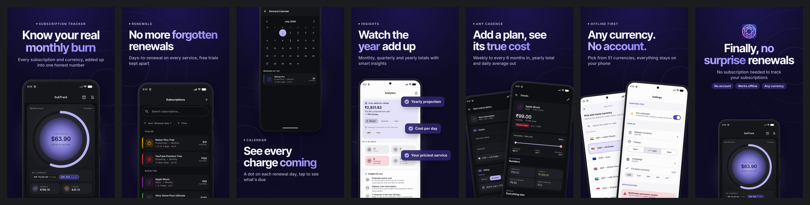
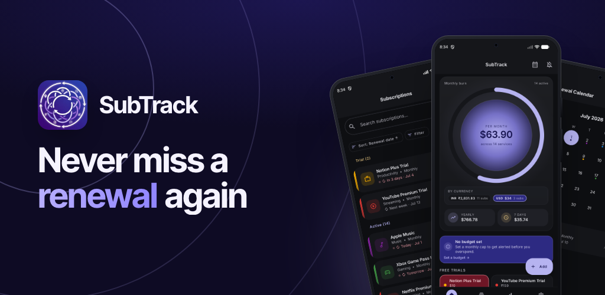
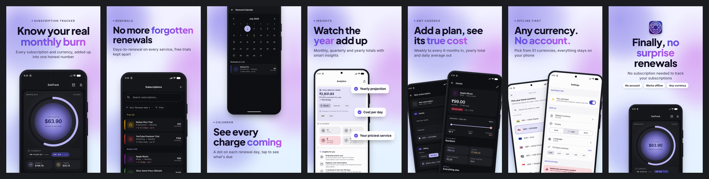

# Mockup Studio

**Your own AI Play Store listing-graphics generator.** You drop your app's screenshots into a folder and describe each
screen. A planner agent (Claude Code, Codex or Muse) then designs an ASO-friendly deck, a template engine renders it as
HTML, and a builder agent reviews and refines it. The output is Play-ready PNGs at 1080×1920, plus a 1024×500 feature
graphic. Guardrails check every step, and a local dashboard lets you edit anything by hand.

It replaces paid tools like screenhance, appscreens, app-mockup and applaunchflow for your own apps.




---

## Samples

All of these were generated from the same 8 raw screenshots of [SubTrack](samples/subtrack/app.json), a subscription
tracker. Each folder has `deck.png`, `feature-graphic.png`, half-size `slides/`, plus the `plan.json` and `app.json`
that produced it.

| Sample | How it was made |
|---|---|
| [`samples/subtrack`](samples/subtrack) | `--planner claude --builder claude`. The agent picked **midnight-glow** to match the app's dark Material 3 UI and wrote all the copy. |
| [`samples/subtrack-light`](samples/subtrack-light) | Same plan with the theme switched to **aurora-light** in the dashboard. No AI, takes seconds. |
| [`samples/subtrack-ref`](samples/subtrack-ref) | **Theme replication.** A sample listing went into `input/reference/`, and the agents copied its look onto SubTrack. |
| [`samples/demo`](samples/demo) | Synthetic finance app (`npm run demo`) for trying the pipeline with no screenshots of your own. |

**aurora-light**


**Reference replication** (left: reference given to the agent · right: result)
<p>


</p>

---

## Quick start

```bash
npm install
npx playwright install chromium
npm run demo                 # builds projects/demo and renders it (no AI)
npm start                    # dashboard → http://localhost:4280
```

You need Node 20+, and at least one agent CLI on your `PATH` and logged in: `claude`, `codex` or `muse`. Check with
`node src/cli.js agents`.

### Your own app in 4 steps

```bash
node src/cli.js new myapp
```

1. **Screenshots** → `projects/myapp/input/screenshots/`. Use raw captures (PNG/JPG). Name them in rough story order
   (`01-home.png`, …).
2. **App info** → `projects/myapp/app.json`. See [`samples/subtrack/app.json`](samples/subtrack/app.json). The most
   important part is `screens`: for each file, say what it shows (`title`, `description`) and give it a `priority`
   (higher means earlier in the deck).
3. *Optional:* put a **sample listing whose look you want** in `input/reference/` (one or more images), and your
   **icon** at `input/icon.png`.
4. Generate:

```bash
node src/cli.js run myapp --planner claude --builder claude --rounds 1
```

PNGs land in `projects/myapp/export/phone/` and `export/feature/`. The dashboard does all of the above with drag-and-drop.

---

## How it works

```
input/screenshots + app.json (+ reference images)
        │
        ▼
 ┌──────────────┐  skills/planner.md + specs + ASO + design system (+ theme replication)
 │ PLANNER agent│  looks at every image → writes plan.json
 └──────┬───────┘
        ▼  guardrail: JSON schema, files exist, highlight ⊂ headline, policy copy, WCAG contrast
        │  (rejected → errors fed back, up to 3 tries → heuristic fallback)
 ┌──────────────┐
 │ RENDERER     │  src/templates: 10 theme presets, 8 phone layouts, 3 feature-graphic layouts,
 │ (deterministic)│ CSS Android frame, auto-fit headlines → build/<slide>.html
 └──────┬───────┘
        ▼
 ┌──────────────┐  Playwright/Chromium → 24-bit PNG, no alpha (Play rule)
 │ EXPORT + QA  │  checks: canvas size, safe area, min font, clipping, headline over screen,
 └──────┬───────┘  only Google Fonts allowed as network → .runs/qa.json + contact sheet
        ▼
 ┌──────────────┐  skills/builder.md — reviews contact sheet vs reference, edits plan.json
 │ BUILDER agent│  or hand-edits build/<slide>.html ("mode": "custom")
 └──────┬───────┘
        ▼  guardrail: invalid plan → rollback; custom slide failing QA → reverted to template
     export/phone/*.png  export/feature/feature-graphic.png
```

Everything an agent produces is checked by code, never trusted. The worst case is a clean template deck.

---

## The agent skills (`skills/`)

The pipeline inlines these into each agent's prompt. Edit them to change how your agents think, and no code changes
are needed.

| File | Used by | What it teaches |
|---|---|---|
| [`planner.md`](skills/planner.md) | planner | Role, step-by-step procedure, `plan.json` shape |
| [`builder.md`](skills/builder.md) | builder | Review procedure, when to edit plan vs HTML, craft checklist |
| [`play-store-specs.md`](skills/play-store-specs.md) | both | Exact Play sizes, first-3-slides rule, thumbnail legibility, metadata policy |
| [`aso-copywriting.md`](skills/aso-copywriting.md) | planner | Deck narrative (hero → differentiator → features → proof → closer), headline formulas |
| [`design-system.md`](skills/design-system.md) | both | Canvas, layouts, theme tokens, preset-by-category table |
| [`theme-replication.md`](skills/theme-replication.md) | both, if references exist | Reading a reference deck like a designer and mapping it to tokens |
| [`guardrails.md`](skills/guardrails.md) | both | The rules code enforces, and which files each agent may touch |

The plan contract is [`schemas/plan.schema.json`](schemas/plan.schema.json).

### Agents (`config/agents.json`)

Each agent is a headless CLI adapter. The placeholders are `{prompt}`, `{project}`, `{images}` (expanded with
`imageArgs` once per image) and `{model}`.

| id | CLI | Notes |
|---|---|---|
| `claude` | `claude -p` | Runs with `--setting-sources project,local --strict-mcp-config`, so your personal hooks and MCP servers don't leak in. It gets image paths and reads them with its Read tool. |
| `codex` | `codex exec -s workspace-write -C <project>` | Images attached with `-i`. |
| `muse` | `muse exec --workspace <project>` | Images attached with `--image`. |

To add another agent, add an entry with a command that can read and write files in a working directory. You can mix
agents, for example `--planner codex --builder claude`. Use `--model <id>` to pick a model.

---

## Dashboard (`npm start`)

1. **Inputs**: app info form, drag-and-drop screenshots with per-screen title, description and priority, reference
   images, icon.
2. **Plan & theme**: every theme token and every slide field as a form, or raw JSON. Add, reorder or delete slides.
   Live validation. *Quick plan (no AI)* builds an instant draft.
3. **Preview & edit**: live HTML previews with QA status. Click a slide to edit its HTML in place. Edited slides become
   `custom` and survive re-renders. *Reset to template* undoes this.
4. **Export**: 1× / 1.5× / 2× PNGs, per-file download, or a zip of everything.

**Generate** runs the whole pipeline with the planner and builder you choose, and streams logs live.

## CLI

```
node src/cli.js new <project>
node src/cli.js run <project> [--planner heuristic|claude|codex|muse] [--builder template|claude|codex|muse]
                              [--rounds n] [--steps plan,build,export] [--model id] [--scale 1|1.5|2]
node src/cli.js build <project>        # re-render HTML from plan.json (keeps custom slides)
node src/cli.js export <project>       # PNGs + QA
node src/cli.js validate <project>
node src/cli.js serve [--port 4280]
node scripts/collect-samples.js <project>   # copy outputs into samples/
npm test
```

Projects live in `projects/` (git-ignored except the demo). Set `MOCKUP_PROJECTS_DIR` to keep them elsewhere.

## Themes & layouts

**Presets:** `aurora-light` · `midnight-glow` · `bold-gradient` · `swiss-paper` · `clay-wellness` · `neon-night` ·
`editorial-serif` · `candy-pop` · `ocean-calm` · `mono-minimal`. Any token can be overridden, and any Google Font
works.

**Phone layouts:** `hero` · `device-bottom` · `device-top` · `tilted` · `two-devices` · `callouts` · `zoom` (magnified
detail card) · `closer` (icon + badges).

**Feature graphic:** `fg-split` · `fg-centered` · `fg-fan`.

## Prior art

Before building, I surveyed GitHub. The closest project is
[ParthJadhav/app-store-screenshots](https://github.com/ParthJadhav/app-store-screenshots) (MIT, ~7k★), a Next.js
editor skill. It is iOS-first and has no autonomous planner/builder loop or Play guardrails. Its core idea,
*"screenshots are advertisements, not documentation"*, and its copy formulas are adapted in
`skills/aso-copywriting.md`. [devices.css](https://github.com/picturepan2/devices.css) inspired the CSS-only device
frame. Mockup Studio adds an Android-first headless pipeline, multi-agent support, reference theme replication, and
code-enforced QA.

## License

MIT
